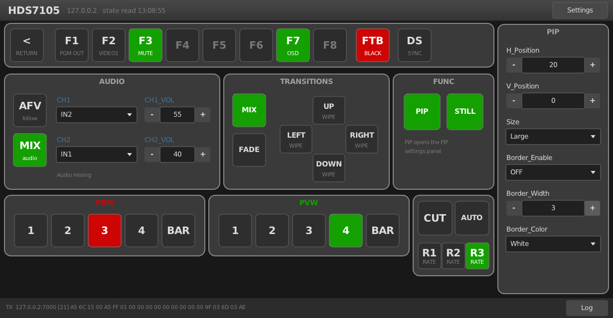

# HDS7105 / HDS7106 switcher control for Linux

An open reimplementation of DeviceWell's Windows control software
(`SWITCHER.exe`) for the **HDS7105** family (HDS7105, HDS7105S,
HDS7105(2021)) and **HDS7106** live-production video switchers. The new
app is written in C with a [raylib](https://www.raylib.com/) GUI.



The switchers are controlled over Ethernet with a small UDP protocol on
port 7000. That protocol was not documented, so it was recovered from the
original Windows binary (a Qt 5 debug build with full symbols). It has
been checked against a real HDS7105(2021): discovery, state read-back and
the control panel all work.

## Contents

| Path | What it is |
|---|---|
| [`docs/USER_GUIDE.md`](docs/USER_GUIDE.md) | How to connect a switcher and use the app |
| [`docs/HARDWARE.md`](docs/HARDWARE.md) | What is known about the hardware: models, ports, specs, sources |
| [`PROTOCOL.md`](PROTOCOL.md) | The UDP protocol: frame format, every opcode and status byte, with the address in `SWITCHER.exe` each came from |
| [`switcher/`](switcher/) | The Linux app: sources, tests, device simulator ([build and developer notes](switcher/README.md)) |
| [`re/`](re/) | The scripts used to analyse `SWITCHER.exe` |

## Quick start

```sh
cd switcher
cmake -S . -B build && cmake --build build -j
./build/switcher                      # broadcast search, then double-click the switcher
./build/switcher --probe 192.168.1.7  # or ask one address directly
```

You need a C compiler, CMake, and the X11/OpenGL development headers.
raylib 5.5 is included in `switcher/third_party/raylib`. To try the app
without hardware, run the simulator:
`python3 switcher/tools/fakedev.py --ip 127.0.0.2 &` and then
`./build/switcher --probe 127.0.0.2`.

## Status

* **HDS7105 family**: complete control panel, state read-back, PIP
  settings, switcher IP, and streaming-module network and URL settings.
  Tested on real hardware.
* **HDS7106**: complete control panel (T-bar, PIP/POP, audio). The
  original tool never reads a 7106's state back, so neither does this one.
  Tested against the simulator only.
* **Sync time** (both panels): sets the switcher's date and time to the
  PC's local time. DeviceWell does this with a separate Windows tool;
  its frame was recovered from that tool and checked on the HDS7105(2021).
* Not covered: logo upload and other features of newer DeviceWell
  software.

## Legal

This is an independent, interoperability-driven reimplementation. It
contains no code or artwork from `SWITCHER.exe`, and the vendor binary is
not part of this repository. DeviceWell and the product names belong to
their owners. raylib is under its own zlib licence
(`switcher/third_party/raylib/LICENSE`).
