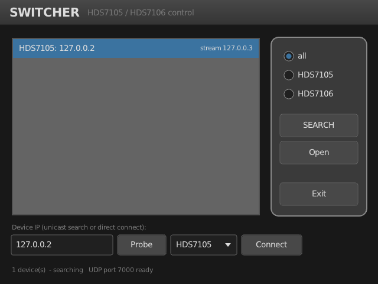
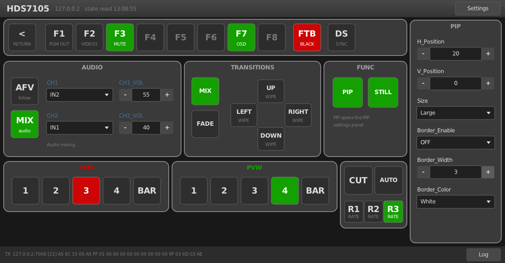
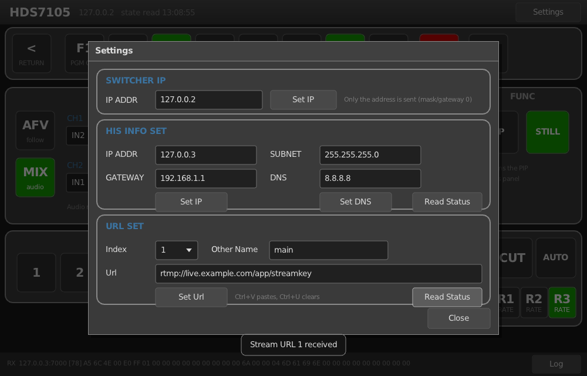
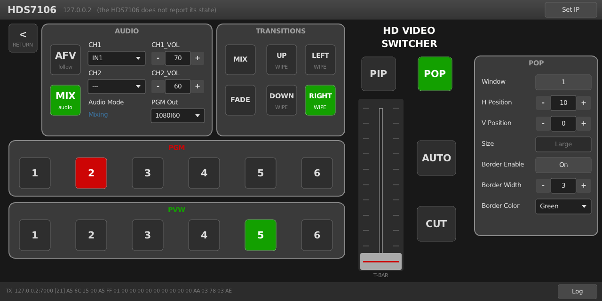

# SWITCHER for Linux: user guide

This app controls DeviceWell **HDS7105** (HDS7105, HDS7105S, HDS7105(2021))
and **HDS7106** video switchers over Ethernet. It does the same job as the
vendor's Windows tool `SWITCHER.exe` and offers the same controls.

* [1. Install](#1-install)
* [2. Connect the switcher](#2-connect-the-switcher)
* [3. Find and open a switcher](#3-find-and-open-a-switcher)
* [4. HDS7105 control panel](#4-hds7105-control-panel)
* [5. HDS7106 control panel](#5-hds7106-control-panel)
* [6. Command-line options](#6-command-line-options)
* [7. Troubleshooting](#7-troubleshooting)

## 1. Install

```sh
sudo apt install build-essential cmake libx11-dev libxrandr-dev \
     libxinerama-dev libxcursor-dev libxi-dev libgl-dev   # Debian/Ubuntu
cd switcher
cmake -S . -B build && cmake --build build -j
sudo cmake --install build        # optional: installs /usr/local/bin/switcher
```

raylib 5.5 is bundled, so nothing else is needed.

## 2. Connect the switcher

The switcher's RJ45 port is its control port. The app talks to it over
UDP port 7000. The PC and the switcher must be able to reach each other at
layer 2, because discovery uses broadcasts. The switcher **only answers
requests that come from an address in its own subnet**. Its IP address is
shown in its own menu (MENU → system/IP settings).

**Same LAN (switch or router).** Plug the switcher into the same switch or
router as the PC. Give it an address in the LAN's subnet, either from its
menu or from the app (see *Settings → SWITCHER IP* below).

Some Wi-Fi routers isolate their wired ports from Wi-Fi clients. The
symptom is that the switcher appears in the search list, but its panel
stays on *"waiting for device state…"*. You have three options:
* Plug the PC in with a cable.
* Turn off the router's port isolation.
* Start the app with `--broadcast-control` (see §6).

**Direct cable to a second network card.** Give that card an address in
the switcher's subnet. If that subnet is already used by another interface
(for example the switcher is `192.168.1.7` and your Wi-Fi is also
`192.168.1.0/24`), route only the switcher's address over the cable, using
your existing address as the source:

```sh
nmcli device modify <cable-nic> +ipv4.routes "192.168.1.7/32 src=<your 192.168.1.x>"
./build/switcher --probe 192.168.1.7
```

This route lasts until the interface is reconnected. In this setup, use
**Probe** (or `--probe`) rather than SEARCH. A broadcast sent out of that
card carries the card's own address, so the switcher ignores it.

**Firewall.** Discovery replies come back to a random UDP port. If a host
firewall is active, allow UDP from the switcher's subnet, for example
`sudo ufw allow from 192.168.1.0/24 proto udp`.

**Optional: watch the program output.** The HDS7105 also shows up as a
USB webcam ("7105 Video In"). That makes it easy to see each command take
effect:

```sh
ffplay -f v4l2 /dev/video6     # pick the right node with: v4l2-ctl --list-devices
```

## 3. Find and open a switcher



Start `switcher`. It broadcasts a search on every network interface and
lists each switcher that answers, for example
`HDS7105(2021): 192.168.1.7`. If a streaming module answers too, it appears
on the right of the same line.

| Control | What it does |
|---|---|
| list | Double-click a switcher, or select it and press **Open**, to open its control panel. |
| all / HDS7105 / HDS7106 | Filter the list by model |
| **SEARCH** | Clear the list and search again |
| **Probe** | Send the search request straight to the IP typed in the box. Use this for switchers behind a router or on a second NIC. |
| model + **Connect** | Open the control panel for that IP without a search reply |
| **Exit** | Quit |

## 4. HDS7105 control panel



When the panel opens, it reads the switcher's complete state, and the
header shows *state read HH:MM:SS*. Buttons light like the hardware panel:
red for program, green for preview and active functions.

> Changes made with the buttons **on the switcher itself** are not shown
> automatically. Press **DS / SYNC** to read the state again. The vendor
> software behaves the same way.

### Top row

| Button | Function |
|---|---|
| **< RETURN** | Back to the search list (the app searches again) |
| **F1** PGM OUT | Opens the output-resolution choice: 1080P60/50, 1080I60/50, 1080P30/25/24 |
| **F2** VIDEO1 | Switches input 1 between HDMI and DP |
| **F3** MUTE | Mutes all audio (lit while muted) |
| **F7** OSD | Assignable function, toggle |
| F4–F6, F8 | Shown for completeness. The original software never sent them (record, stream and mic gain are panel-only). |
| **FTB** | Fade to black. Blinks red while active; press again to restore the picture. |
| **DS** SYNC | Read the full state from the switcher |

### AUDIO

* **AFV** (audio follows video): the program audio comes from the PGM
  source. The CH1/CH2 source boxes are locked in this mode.
* **MIX**: two freely assigned audio channels. Set **CH1** and **CH2** to
  PHONE_IN (3.5 mm line), IN1–IN4 (HDMI embedded), MIC_IN1 or MIC_IN2.
* **CH1_VOL / CH2_VOL**: 0–100. Click **–**/**+**, scroll the mouse wheel,
  or click the number and type a value, then press Enter.

### TRANSITIONS

**MIX** (dissolve), **FADE** (through black) and the four **WIPE**
directions select the effect that AUTO uses. The selected effect is lit
green.

### FUNC

* **PIP** turns picture-in-picture on and opens the **PIP** panel on the
  right:
  * H/V position, in steps of 10. The range depends on the size: up to
    1440×810 for Small, 1280×720 for Medium, 960×540 for Large.
  * Size, border on/off, border width (2–7) and border colour.
* **STILL** freezes the program output. Press it again to release.

### PGM / PVW and transition

* **PGM 1–4** (red) puts an input on air directly. **BAR** is colour bars.
* **PVW 1–4** (green) selects the next source.
* **CUT** swaps PGM and PVW instantly.
* **AUTO** swaps PGM and PVW with the selected transition. The panel
  updates when the transition ends.
* **R1/R2/R3** set the AUTO duration: 640 / 1280 / 2560 ms.

### Settings

The **Settings** button (top right) opens three sections.

* **SWITCHER IP**: type a new address and press **Set IP**. The change is
  sent to the switcher, and the app then talks to the new address. Only the
  address is sent; netmask and gateway are sent as 0, as the original tool
  does. Make sure the new address is in a subnet your PC can reach.
* **HIS INFO SET**: IP, subnet, gateway and DNS of the hardware streaming
  module, the HDS7305 STREAM port. Use **Read Status** to load the current
  values, **Set IP** or **Set DNS** to change them.
* **URL SET**: the module stores 8 RTMP destinations. Pick an **Index**
  (1–8) and press **Read Status** to load it. Edit **Other Name** (up to 16
  characters) and **Url** (up to 768 characters), then press **Set Url**.
  Ctrl+V pastes, Ctrl+U clears a field.

HIS and URL settings are available only when a streaming module answered
the search. Plain HDS7105 units have none, so those sections stay greyed
out.



## 5. HDS7106 control panel



The HDS7106 does not report its state. The original software did not ask
for it either. So the lights show what this panel last sent, and they
start out blank.

* **PGM / PVW 1–6**: the four SDI and two HDMI inputs.
* **T-BAR**: drag it up to run the transition manually, then down for the
  next one. The PGM/PVW lights swap at each end. AUTO is lit while the bar
  is between the ends.
* **AUTO / CUT**: transition with the selected effect, or a hard cut.
* **AUDIO**:
  * AFV or MIX audio mode.
  * CH1/CH2 sources: Phone_IN, RCA_IN, IN1–IN6.
  * Volumes 0–100, in steps of 10. A volume is stored per source, so choose
    the source first.
  * **PGM Out** sets the output resolution.
* **TRANSITIONS**: MIX, FADE, and the four wipe directions.
* **PIP / POP**: switches the inset window on and opens its settings on
  the right. For POP, choose **Window** 1 or 2 before moving it.
* **Set IP** (top right): changes the switcher's address.

## 6. Command-line options

```
switcher [options]
  --connect IP          open the control panel for IP directly
  --model 7105|7106     model for --connect (default 7105)
  --probe IP            also send the search request to IP (unicast);
                        repeated on every SEARCH
  --no-broadcast        never broadcast (only --probe / manual IPs)
  --broadcast-control   send commands to the subnet broadcast address
                        (when ARP to the switcher fails; every switcher on
                        that subnet will obey)
  --port N              switcher UDP port (default 7000)
  --verbose             print every frame sent and received
```

Inside a control panel, **Log** (or F12) shows the frames sent and
received.

## 7. Troubleshooting

| Symptom | Cause / fix |
|---|---|
| "No device found" | The switcher is on another subnet or behind a router, or a firewall drops the reply. Type its IP and press **Probe**. Check the firewall (§2). |
| Listed, but the panel stays on "waiting for device state…" | Unicast does not reach the switcher. Typical causes: ARP blocked by router port isolation, or the switcher's subnet differs from the PC's. Use a direct cable or route (§2), or `--broadcast-control`. Check with `ping` and `ip neigh show <ip>` (`FAILED` means ARP fails). |
| Status line says "UDP port 7000 is busy" | Another program, or a second copy of this app, is using port 7000. Replies to our own requests still work. Close the other program for normal operation. |
| Panel does not match the hardware | Changes made on the switcher's own panel are not pushed to the PC. Press **DS / SYNC**. |
| HIS / URL settings greyed out | No streaming module answered the search. Only models with a STREAM port (HDS7305) have one. |
| After **Set IP** the switcher is gone | It now has an address your PC cannot reach. Change it back from the switcher's menu, or give the PC an address in the new subnet. |

To report a problem, run `switcher --verbose` and include the `TX`/`RX`
lines.
