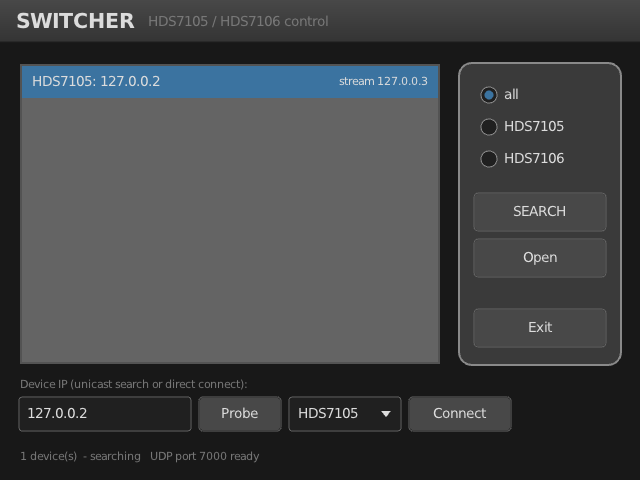
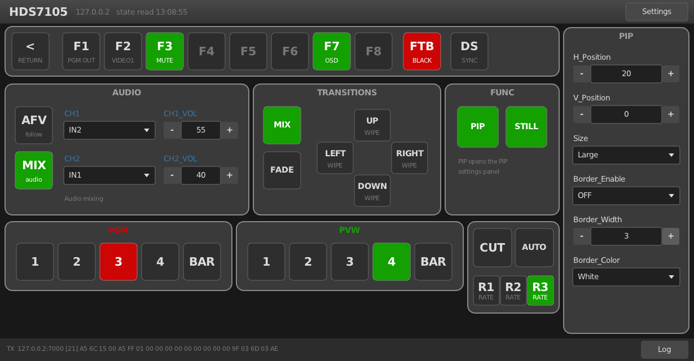
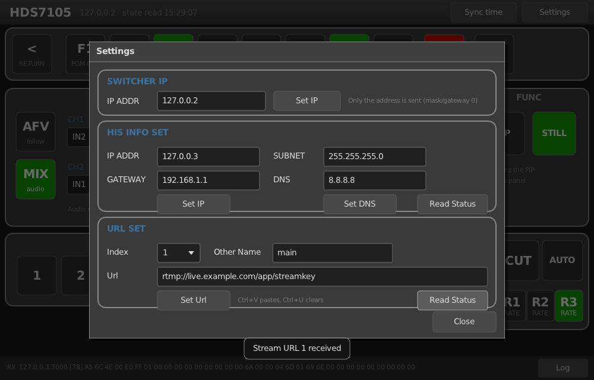
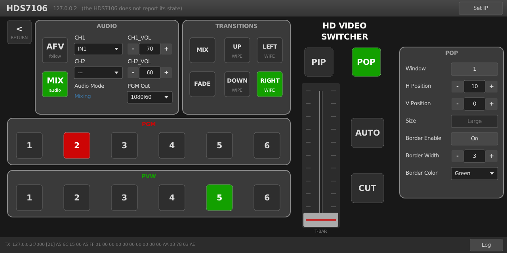

# SWITCHER for Linux

A C reimplementation of the Windows `SWITCHER.exe` control panel for
**HDS7105** (and HDS7105S / HDS7105(2021)) and **HDS7106** HD video
switchers, using [raylib](https://www.raylib.com/) 5.5 for the GUI.

The UDP protocol was recovered from the original binary (a statically
linked Qt 5 debug build with full DWARF info). Every opcode, frame layout
and status-byte offset, with the address of the code it came from, is in
[`../PROTOCOL.md`](../PROTOCOL.md).

End-user documentation is in [`../docs/USER_GUIDE.md`](../docs/USER_GUIDE.md),
and hardware notes are in [`../docs/HARDWARE.md`](../docs/HARDWARE.md). This file
covers building, testing and how the port differs from the original.

| Search | HDS7105 (PIP panel open) |
|---|---|
|  |  |

| HDS7105 settings | HDS7106 (POP panel open) |
|---|---|
|  |  |

## Build

You need a C compiler, CMake ≥ 3.16, and the X11/OpenGL development headers
that raylib uses (on Debian/Ubuntu: `libx11-dev libxrandr-dev libxinerama-dev
libxcursor-dev libxi-dev libgl-dev`). raylib 5.5 is vendored in
`third_party/raylib`; an installed raylib ≥ 5.5 is used instead if CMake
finds one.

```sh
cmake -S . -B build
cmake --build build -j
./build/switcher
```

## Usage

```
switcher [--connect IP [--model 7105|7106]] [--probe IP] [--no-broadcast]
         [--broadcast-control] [--port N] [--verbose]
```

* **Search window**. At startup and on **SEARCH** the app broadcasts the
  discovery frame to UDP port 7000, on 255.255.255.255 and on every
  interface's broadcast address. Found switchers are listed as
  `HDS7105: <ip>`, together with their paired streaming module if there is
  one. Double-click a device, or select it and press **Open**. The radio
  buttons filter the list by model.
* **Devices behind a router**: broadcasts do not cross routers. Type the
  IP and press **Probe** to send the discovery frame straight to it, or
  pick the model and press **Connect** to open the panel without
  discovery.
* **HDS7105 panel**:
  * Top row: **F1** = PGM-out resolution, **F2** = VIDEO1, **F3** = audio
    mute, **F7** = OSD rotating. The meanings come from the vendor's opcode
    enum. F4–F6 and F8 were not connected in the original either.
  * **FTB** blinks while fade-to-black is active. **DS** re-reads the
    device state.
  * The panel reads the full device state when it opens.
  * **Settings** holds the switcher IP, the streaming module's
    IP/subnet/gateway/DNS, and the 8 RTMP URL slots. In the text boxes,
    Ctrl+V pastes and Ctrl+U clears.
* **HDS7106 panel**:
  * The T-bar sends slider positions (opcode 0x82). PIP and POP open their
    settings panels.
  * **Set IP** changes the device address.
  * The HDS7106 never reports its state, so the lights show what this panel
    last sent. The original behaves the same way.
* **Log** (or F12) in the panel footer shows every frame sent and received.
  `--verbose` prints the same lines to stdout.

**When ARP fails.** Some Wi-Fi routers isolate their LAN ports, so ARP
between the PC and the switcher fails while broadcasts still pass. In
that case discovery works, but unicast commands never leave the PC (the
kernel cannot resolve the device's MAC address), and the panel stays on
"waiting for device state…". There are two fixes:

* **`--broadcast-control`**: sends every command to the subnet broadcast
  address of the interface that reaches the device. The device accepts
  this, and its replies come back as unicast. Every switcher on that
  subnet will act on the commands.
* **Static neighbour entry**: keeps normal unicast. Find the device's MAC,
  either from the router's DHCP list or with
  `sudo tcpdump -eni <iface> -c 2 udp port 7000` while the app searches.
  Then add it:
  `sudo ip neigh replace 192.168.1.7 lladdr <MAC> dev <iface> nud permanent`.

**Switcher plugged straight into a second NIC.** The device only
answers senders in its own subnet. If that subnet (for example
192.168.1.0/24) is already used by another interface, route just the
device's address over the second NIC, using a source address from that
subnet. The device must answer ARP for this to work. Then use **Probe** or
`--probe` with its IP, because a broadcast on that NIC carries the NIC's
own address and gets no answer:

```sh
nmcli device modify <nic> +ipv4.routes "192.168.1.7/32 src=<your 192.168.1.x address>"
./build/switcher --probe 192.168.1.7
```

The app binds UDP port 7000, like the original. Discovery replies come
back from each device's own address to an ephemeral port, and a stateful
firewall cannot match them to the broadcast. If a host firewall is
active, allow UDP from the switchers' subnet. For example, with ufw:
`sudo ufw allow from 192.168.1.0/24 proto udp`. If port 7000 is already
taken, for example by a second instance, the app falls back to an
ephemeral port and says so in the status line.

## Tests

```sh
build/test_proto            # golden frame vectors + reply decoders (no GUI)
tests/e2e.sh 7105           # full UI run against a simulated HDS7105
tests/e2e.sh 7106           # same for the HDS7106 (T-bar, PIP/POP, IP dialog)
```

* **Simulator**: `tools/fakedev.py` is a fake switcher plus streaming
  module, written from PROTOCOL.md independently of the C code. It answers
  discovery, state (0x49), IP-info (0x24) and URL (0x6A) requests, applies
  commands to its state, and can record every frame it receives
  (`--record`). It decodes time-sync frames and checks the BCD date and
  time against its own clock (`SW FF @time` in an `.expect` file).
* **How e2e.sh runs**: it starts the simulator on 127.0.0.2/127.0.0.3. It
  then runs the app in a hidden window and drives it with a click script
  (`tests/e2e_*.script`). The mouse is injected through raylib, so your
  pointer is not touched. Finally it checks the recorded frames, opcode by
  opcode, against `tests/e2e_*.expect`. No broadcast is sent during the
  tests.
* **Display**: the tests need an X display, but the window stays hidden.

To try the UI by hand without hardware:

```sh
python3 tools/fakedev.py --ip 127.0.0.2 --his-ip 127.0.0.3 &
./build/switcher --probe 127.0.0.2
```

## Differences from the original

These behaviours are kept from the original, quirks included:

* Frame formats are ported byte for byte from the disassembly. That
  includes the `Set_ipCom` frame, which drops byte 6 for E5-type streaming
  modules, and the constant `02 50 3B 8C` tail of the DNS frame. They have
  not yet been compared on the wire with `SWITCHER.exe` or a real device.
* The **AFV** button sends 0xCC and **MIX** sends 0xCB, even though the
  vendor enum names those two opcodes the other way round.
* CUT and AUTO swap the PGM/PVW lights locally. AUTO swaps them after
  900 ms.
* On the HDS7106 both channel volumes use opcode 0xB8, keyed by source.
* Changing the switcher IP sends the change to the old address, then
  continues on the new one.

These were deliberately changed:

* Replies are parsed per datagram. The original kept an accumulation buffer
  that latched dead after 1056 bytes.
* Reply payloads are located with `sw_slice_after()`. The original used
  `QByteArray::split()`, which broke when a separator byte appeared inside
  the data, for example an IP octet of 36.
* Name, URL and device-table copies are bounds-checked.
* The T-bar direction flip triggers at the end of the range (`>=`), not on
  one exact value. This avoids the original getting stuck after a fast drag.
* The UI never re-sends a value just because a status reply updated it. The
  original's `setCurrentIndex()` did.
* The 900 ms AUTO wait is a timer, not a busy loop.
* A refused change (POP position before choosing a window, or volume before
  choosing a source) is reverted on screen.
* Duplicate discovery replies are merged. A streaming module that answers
  before its switcher is still paired with it.
* **Sync time** is not part of `SWITCHER.exe`. It ports the frame of
  DeviceWell's separate "Time synchronization V1.1.exe" (see
  `PROTOCOL.md`). That tool broadcasts the frame to every switcher on
  the LAN. This app sends it only to the switcher whose panel is open.
* Standard window decorations replace the original frameless window with
  its custom title bar. The vendor's bitmap artwork is not used; buttons
  are drawn with text labels.

## Layout

```
src/proto.[ch]      frame builders, checksum, datagram parser (no GUI)
src/net.[ch]        UDP sockets, broadcast discovery
src/devices.[ch]    discovery list, model codes, streaming-module pairing
src/session.[ch]    send helpers bound to one device
src/hds7105.[ch]    HDS7105 commands + state/HIS/URL reply decoding
src/hds7106.[ch]    HDS7106 commands + T-bar state machine
src/ui.[ch]         small immediate-mode widget kit on raylib
src/screen_*.c      search, HDS7105 and HDS7106 windows
src/testhook.[ch]   scripted input for the e2e tests (--script)
tools/fakedev.py    device simulator
tools/timesync.py   set switcher clocks from the command line (no GUI)
tests/              unit test, e2e scripts and expectations
```
